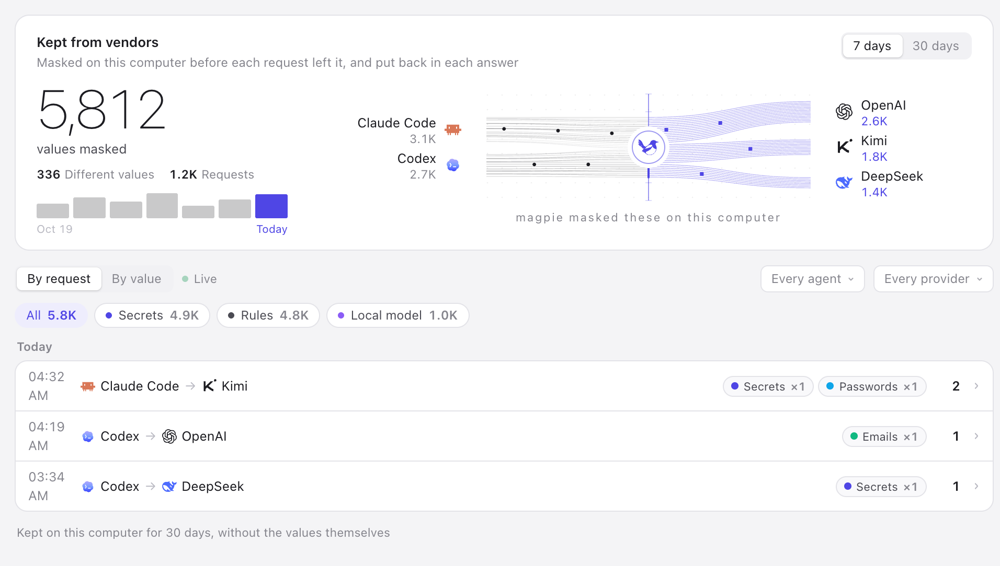

<div align="center">

<a href="https://usemagpie.ai"></a>

# magpie

### El modelo de cada agente. En un solo lugar.

**Claude Code con Kimi. Codex con DeepSeek. Gemini CLI con GLM. OpenCode con tu plan de ChatGPT.**<br>
Cambia cualquiera de ellos desde la barra de menú. Un solo gateway local los atiende a todos,<br>
y cuando se agota una cuota, pasa silenciosamente a tu siguiente cuenta.

[](https://github.com/yetone/magpie-releases/releases/latest) [](https://github.com/yetone/magpie/stargazers) [](https://discord.gg/vGSnD3ZKQF) [](LICENSE)<br>
    

Gracias a [Kimi](https://usemagpie.ai/go/kimi/readme) por apoyar a magpie y a la comunidad de código abierto.

<sub>Patrocinadores</sub>

<a href="https://usemagpie.ai/go/apikeyfan/readme"><picture><source media="(prefers-color-scheme: dark)" srcset="site/public/img/sponsor-apikeyfan-dark.svg"></picture></a><br>
<a href="https://usemagpie.ai/go/wandapi/readme"><picture><source media="(prefers-color-scheme: dark)" srcset="site/public/img/sponsor-wandapi-dark.svg"></picture></a>&emsp;&emsp;<a href="https://usemagpie.ai/go/aigocode/readme"><picture><source media="(prefers-color-scheme: dark)" srcset="site/public/img/sponsor-aigocode-readme-dark.png"></picture></a><br>
<a href="https://usemagpie.ai/go/modelgo/readme"><picture><source media="(prefers-color-scheme: dark)" srcset="site/public/img/sponsor-modelgo-dark.svg"></picture></a>&emsp;&emsp;<a href="https://usemagpie.ai/go/x6ai/readme"><picture><source media="(prefers-color-scheme: dark)" srcset="site/public/img/sponsor-x6ai-dark.svg"></picture></a>

**[Descargar](https://usemagpie.ai)** &nbsp;·&nbsp; **[Documentación](https://usemagpie.ai/docs/start)** &nbsp;·&nbsp; **[Referencia](docs/reference.md)** &nbsp;·&nbsp; **[Plugins](https://github.com/magpie-community/plugins)** &nbsp;·&nbsp; **[Discord](https://discord.gg/vGSnD3ZKQF)** &nbsp;·&nbsp; [English](README.en.md) · **Español (Latinoamérica)** · [简体中文](README.zh-CN.md)

<br>

<picture>
  <source media="(prefers-color-scheme: dark)" srcset="site/public/img/agents-dark.png">
  
</picture>

</div>

<br>

## ¿Es magpie para ti?

Cada agente guarda su modelo en su propio archivo, en su propio formato, con sus propias claves y URLs base. Una suscripción que pagas funciona en un solo agente y en ningún otro lugar. magpie reúne todo eso detrás de una sola aplicación y un solo gateway local:

- **Elige cualquier modelo para cualquier agente** desde una única lista. magpie edita únicamente la clave que importa en la propia configuración del agente.
- **Usa un solo proveedor en todas partes**: una clave de API, un modelo local o el plan de Claude, ChatGPT, Copilot, Gemini o Grok en el que hayas iniciado sesión.
- **Sigue trabajando cuando se agote una cuota**: la siguiente cuenta del proveedor toma el relevo, y un grupo de enrutamiento pasa a otro modelo o proveedor, por lo que el agente nunca ve el error. Con una sola cuenta y sin ningún grupo no hay nada a qué cambiar, y el error llegará al agente.
- **Mantén tus secretos fuera de los servidores de los proveedores**: una vez que actives el enmascaramiento en **Configuración → Privacidad** (desactivado por defecto), las claves, contraseñas y correos electrónicos en un prompt se enmascaran en tu computadora antes de que la solicitud salga de ella, y se restauran en la respuesta.

Es para ti si utilizas más de un agente, más de un proveedor o más de una cuenta. Si usas un solo agente con el plan oficial de su proveedor y eso te basta, no lo necesitas.

Funciona en macOS, Windows y Linux (aplicación en la barra de menú, ventana, TUI, interfaz web y CLI), en Docker y en Termux.

## Inicio rápido

**1 · Instalar.** Descarga la aplicación desde **[usemagpie.ai](https://usemagpie.ai)**, o ejecuta:

```sh
curl -fsSL https://usemagpie.ai/install.sh | sh
```

<sub>Las versiones para Mac están firmadas y notarizadas, cada archivo de versión incluye una atestación de compilación de GitHub Actions (`gh attestation verify <file> -R yetone/magpie-releases`), y cada compilación se actualiza automáticamente. En Linux, el script instala la aplicación de escritorio; si el escritorio no cuenta con WebKitGTK 4.1, lo instala primero con tu gestor de paquetes (sudo te pedirá tu contraseña); sin entorno de escritorio o sin terminal para preguntar, instala la versión de terminal e indica qué paquete debes agregar. `--gui` o `--tui` permite elegir. Detrás de un firewall, usa `--proxy` o `--mirror`. O bien `go install github.com/yetone/magpie@latest`, o la [imagen de Docker](https://usemagpie.ai/docs/docker). Desinstala magpie con `curl -fsSL https://usemagpie.ai/install.sh | sh -s -- --uninstall`: restaura tus agentes a su estado original y luego elimina lo instalado por el script (si magpie ya fue eliminado, descarga una copia para restaurarlos); tu configuración en `~/.config/magpie` se conserva a menos que agregues `--purge`.</sub>

**2 · Agregar un proveedor.** Abre magpie y ve a **Proveedores → Agregar proveedor**. Elige un ajuste predeterminado y pega una clave, o inicia sesión con una suscripción.

**3 · Elegir un modelo** para cada agente en la página de **Agentes**. Inicia una nueva sesión y ya estará usando el nuevo modelo.

O hazlo todo desde la terminal:

```sh
magpie provider add deepseek sk-…              # un ajuste predeterminado solo necesita la clave
magpie claude deepseek/deepseek-v4-pro          # Claude Code con DeepSeek
magpie codex moonshot/kimi-k2.5                 # Codex con Kimi
magpie group add "Opus anywhere" models=claude/claude-opus-5-5,copilot/claude-opus-5.5 routing=smart
magpie claude group/opus-anywhere               # conmuta por error entre suscripciones
magpie save work && magpie use work             # perfiles
magpie quota                                    # lo que queda en cada plan
magpie settings set theme dark                  # cada opción de Configuración, desde la terminal
magpie tool generate_image "una urraca, acuarela" -o hero.png   # herramientas de imagen, visión y búsqueda de magpie, llamadas directamente
magpie tui                                      # todo completo, en una terminal
```

magpie encuentra las suscripciones en las que tus agentes tienen la sesión iniciada leyendo sus credenciales (los archivos de Claude Code y Codex, el Llavero). Para evitar que las lea, desactiva Configuración → Privacidad → *Cuentas de suscripción*, o ejecuta `magpie accounts discovery off` (`on` vuelve a activarlo). `MAGPIE_NO_ACCOUNTS=1` lo desactiva para una sola ejecución sin modificar la configuración guardada. Los proveedores con clave de API funcionan de cualquier forma.

## Agentes compatibles

<table>
<tr><td>

Claude Code · Claude Desktop · Claude Science · Codex · Gemini CLI · Antigravity CLI · Dim · OpenCode · OpenChamber · MiMo Code · DevEco Code · Pi · oh-my-pi · StepCode · MothX · PenguinHarness · Aside · OmO · Prime Agent · mu · Goose · Cursor CLI · Cursor Private Inference · Zed · VS Code Chat · VS Code Insiders · VSCodium Chat · Zoo Code · JetBrains Air · Air (JetBrains IDEs) · Copilot (JetBrains) · Copilot CLI · Crush · DeepSeek Harness · Reasonix Studio · Command Code · fx · Devin · Hermes Agent · Mister Morph · Kimi Code · jcode · Mistral Vibe · Qwen Code · Muse Code · Empryo · nanobot · miniQ · Paimon · MiniMax Code · Droid · Cline · Qoder · Qoder CN · Grok Build · Grok App · ZCode · WorkBuddy · WorkBuddy AI · CodeBuddy · Pencil · Paseo · OpenPencil · OpenBot · Craft Agents · Tuanjie Cowork · NewMax · LiveAgent · Raycast · Kiro Crew · OpenMausBot · T3 Code · OpenHanako · AtomCode · Open Code Review · Snow CLI · Alma · Shelley · Cindy · Lody · AionUi · Cherry Studio · Ante · AstrBot · QwenPaw · OpenClaw · Avibe · Kun

</td></tr>
</table>

magpie muestra solo los agentes instalados en tu equipo; las notas de configuración para algunos de ellos se encuentran en la [referencia](docs/reference.md#notes-on-some-agents) (en inglés). Cualquier otra herramienta que acepte una URL base también puede usar el gateway:

```sh
export OPENAI_BASE_URL=http://127.0.0.1:3425/v1     OPENAI_API_KEY=magpie
export ANTHROPIC_BASE_URL=http://127.0.0.1:3425     ANTHROPIC_API_KEY=magpie
export GOOGLE_GEMINI_BASE_URL=http://127.0.0.1:3425 GEMINI_API_KEY=magpie
```

## Cómo funciona todo

El gateway en `127.0.0.1:3425` es compatible con OpenAI Chat, OpenAI Responses, Anthropic Messages y Gemini, y traduce entre ellos de forma transparente, incluyendo streaming, llamadas a herramientas y razonamiento.

<picture>
  <source media="(prefers-color-scheme: dark)" srcset="site/public/img/architecture-dark.svg">
  
</picture>


## Qué hace

### Cualquier modelo, cualquier agente

Haz clic en un valor y se abrirá una lista con búsqueda: cada modelo de cada proveedor que agregaste, con el formato `proveedor/modelo`. La configuración del agente se reescribe de forma atómica, conservando sus comentarios, orden y formato originales. Los **Perfiles** guardan la configuración de todos los agentes bajo un solo nombre ("Económico", "Enfoque") y permiten alternar entre ellos en un solo paso. Cada agente también puede tener su propia lista rápida de modelos; el perfil también almacena esa lista.

<table>
<tr>
<td width="50%">
<picture>
  <source media="(prefers-color-scheme: dark)" srcset="site/public/img/panel-dark.png">
  
</picture>
</td>
<td width="50%">
<picture>
  <source media="(prefers-color-scheme: dark)" srcset="site/public/img/picker-dark.png">
  
</picture>
</td>
</tr>
</table>

### Enmascaramiento de privacidad

Los agentes introducen en el prompt lo que leen: un `.env`, un archivo de configuración, un registro con un token. Con el enmascaramiento activado, magpie sustituye esos valores por marcadores de posición en tu computadora antes de que la solicitud salga de ella, y los restaura en la respuesta. Tu agente y tus archivos conservan los valores reales; el proveedor externo nunca llega a verlos.

<picture>
  <source media="(prefers-color-scheme: dark)" srcset="site/public/img/masking-dark.png">
  
</picture>

| | |
| :-- | :-- |
| **Detección de dos formas** | Reglas para lo certero (claves de API, claves privadas, tokens, correos y números de tarjetas e identificación cuyo dígito verificador coincide) y, si lo deseas, un modelo que se ejecuta en esta computadora para nombres, direcciones y contraseñas que ninguna regla detecta (descarga de 1.6 GB, ejecutada en la CPU) |
| **Restauración en todas partes** | Un valor se convierte en un marcador como `{{API_KEY_k3v9x2mq}}`, y cada marcador en la respuesta vuelve a su valor original: texto en streaming y argumentos de llamadas a herramientas incluidos, para que un comando ejecutado por el agente use la clave real |
| **Nada se rompe** | Un mismo valor recibe el mismo marcador en cada ocasión, manteniendo válidos la conversación, la caché de prompts y las firmas de razonamiento (thinking). Un valor enmascarado una vez se enmascara dondequiera que aparezca después |
| **Nunca en disco** | Los valores se retienen únicamente en memoria. El registro solo almacena el tipo, longitud y primeros caracteres de cada valor. Si el enmascaramiento está activo y no puede ejecutarse, la solicitud se retiene (503) y nunca se envía con los datos originales |
| **Tú lo puedes verificar** | **Métricas › Enmascaramiento** enumera cada solicitud modificada, mostrando en paralelo lo que recibió el proveedor, y **Probar** en Configuración muestra cómo quedaría cualquier texto |
| **Tus propias reglas** | Secretos y datos personales activables por separado, categorías detalladas (pasaporte, IBAN, MAC, IP pública…), tus propias palabras y patrones, y si un valor detectado debe ser enmascarado, advertido o bloqueado (**Enmascarar**, **Advertir**, **Bloquear**) |

El costo: el modelo ve `{{API_KEY_…}}` en lugar de la clave real, por lo que una tarea centrada en el valor mismo (¿por qué se rechaza este token?) no se puede procesar sobre él. Puedes agregar esos valores en **Nunca enmascarar**. Las reglas pueden equivocarse ocasionalmente; la página de Enmascaramiento te permite comprobarlo. Está desactivado hasta que lo habilites en **Configuración → Privacidad**. Los correos electrónicos en dominios de ejemplo (`example.com`, `.test`, `.invalid`) se dejan tal como fueron escritos.

### Proveedores

Elige un ajuste predeterminado y pega una clave. Las listas de modelos provienen directamente del proveedor, con nombres y niveles de razonamiento completados desde [models.dev](https://models.dev), de modo que un modelo lanzado esta mañana aparecerá en tu selector en la siguiente actualización.

> **Los ajustes predeterminados incluyen** Anthropic · OpenAI · Google Gemini · Google Vertex AI · Amazon Bedrock (runtime y Mantle) · DeepSeek · Kimi · Zhipu GLM · MiniMax · StepFun · LongCat · Qwen · Baidu Qianfan · Tencent Cloud · Huawei Cloud MaaS · Volcengine Ark · Mistral · Voyage AI · Groq · Nous Portal · xAI · OpenRouter · Vercel AI Gateway · GMI Cloud · Together · Fireworks · Fireworks Nexus · SiliconFlow · NVIDIA NIM · ModelScope · Ollama · LM Studio … y cualquier URL compatible con OpenAI o Anthropic.

**Importar** incorpora los proveedores configurados en CC Switch, Claude Code, Codex y Alma. Los enlaces de **[Agregar a magpie](https://usemagpie.ai/docs/import)** permiten que el sitio web de un proveedor transmita su configuración a magpie con un solo clic. Cada clave y cada cuenta pueden comunicarse a través de su propio proxy independiente.

<picture>
  <source media="(prefers-color-scheme: dark)" srcset="site/public/img/add-dark.png">
  
</picture>

### Suscripciones

Un agente en el que iniciaste sesión es una suscripción con modelos disponibles, por lo que magpie la ofrece como proveedor a cualquier otro agente. Agrega varias cuentas por suscripción y magpie conmutará automáticamente entre ellas cuando una falle o se agote.

- **Claude**: controla el binario local real de `claude` y conecta las herramientas de tu agente a través de MCP
- **Codex / ChatGPT**: los modelos de tu plan de ChatGPT, disponibles en cualquier otro agente
- **GitHub Copilot**, **Gemini (Code Assist)**, **Antigravity** (a través de tu propio CLI de agy), **Grok (SuperGrok)** y más
- **Cualquier plugin de autenticación de OpenCode o paquete de pi** desde npm

El **calentamiento diario** inicia la ventana de 5 horas de cada cuenta de Claude y ChatGPT en los horarios que elijas, o en el instante en que la última se restablezca.

### Grupos de enrutamiento

Un **grupo de enrutamiento** agrupa varios modelos para que un agente los elija como una sola opción, como `group/daily-coding`. El gateway distribuye las solicitudes entre las claves y cuentas de todos los miembros:

| Modo | Qué hace |
| :-- | :-- |
| **`smart`** | De las suscripciones con cuota restante, usa la que se renueva más pronto, reduciendo el desperdicio en el reinicio |
| **`order`** | Usa el primer modelo hasta que no pueda responder, luego pasa al siguiente |
| **`rotate`** | Pasa al siguiente miembro en cada turno |
| **`usage`** | Usa primero el miembro menos utilizado |
| **`pace`** | Usa la cuenta con mayor proporción de cuota semanal restante por hora antes del reinicio |

Una conversación **permanece con la cuenta que la respondió** mientras valga la pena mantener la caché de prompts del proveedor. Los grupos pueden contener otros grupos. El **[enrutamiento por intención](https://usemagpie.ai/docs/intent)** hace que un modelo ligero de tu elección analice cada nuevo turno, asignando tareas complejas (como pruebas) al modelo potente y preguntas rápidas al modelo económico. La vista de Enrutamiento muestra cada decisión en vivo.

<picture>
  <source media="(prefers-color-scheme: dark)" srcset="site/public/img/routing-dark.png">
  
</picture>

<table>
<tr>
<td width="50%">
<picture>
  <source media="(prefers-color-scheme: dark)" srcset="site/public/img/intent-trace-dark.png">
  
</picture>
</td>
<td width="50%">
<picture>
  <source media="(prefers-color-scheme: dark)" srcset="site/public/img/nested-routing-dark.png">
  
</picture>
</td>
</tr>
</table>

### Plugins

```sh
magpie plugin add opencode-gemini-auth   # un plugin de OpenCode desde npm
magpie plugin login google-plugin        # su propio flujo de inicio de sesión, en magpie
```

Los plugins se ejecutan en [Bun](https://bun.sh), que se descarga la primera vez que se necesita. Un plugin inicia sesión, lista sus modelos y procesa cada solicitud; los agentes usan esos modelos igual que los de cualquier otro proveedor. Explora **[magpie-community/plugins](https://github.com/magpie-community/plugins)** o [crea el tuyo propio](https://usemagpie.ai/docs/plugins).

Un plugin también puede actuar como **middleware de gateway**: código JavaScript que inspecciona lo que cada agente envía y recibe. `onRequest` puede reescribir una solicitud o rechazarla, `onEvent` monitorea cada evento transmitido en streaming y `onResponse` la respuesta completa. Un hook que lance un error o tarde demasiado tiempo dejará la solicitud intacta.

```js
// alias.middleware.js — magpie plugin add ./alias.middleware.js
export function onRequest(body, ctx) {
  if (body.model === "fast") return { ...body, model: "deepseek/deepseek-chat" };
}
```

<details>
<summary><b>Middleware preconstruido</b>, en su mayoría equivalente a lo que <a href="https://github.com/QuantumNous/new-api">New API</a> hace para sus canales, con el mismo formato JSON</summary>

<br>

| Paquete | Qué hace |
| :-- | :-- |
| `param-override` | El `param_override` de New API: establece, elimina, mueve o reescribe campos de la solicitud según condiciones, o rechaza una solicitud |
| `model-map` | El `model_mapping` de New API: envía una solicitud a un modelo bajo otro nombre; las respuestas conservan el nombre solicitado originalmente |
| `system-prompt` | Tu prompt de sistema en cada solicitud, o solo para ciertos agentes o modelos |
| `word-guard` | El filtro de palabras sensibles de New API: rechaza o enmascara palabras en lo que envían los usuarios y en las respuestas |
| `think-tags` | Quita las etiquetas `<think>…</think>` de las respuestas o inserta `reasoning_content` en ellas |

```sh
magpie plugin add @magpie-community/middleware-model-map
magpie plugin options model-map '{"mapping": {"fast": "deepseek/deepseek-chat"}}'
```

Encuéntralos en Plugins › Descubrir › Middleware de gateway. Consulta [Middleware de gateway](https://usemagpie.ai/docs/plugins#middleware).

</details>

### Uso y costos

<picture>
  <source media="(prefers-color-scheme: dark)" srcset="site/public/img/usage-dark.png">
  
</picture>

| | |
| :-- | :-- |
| **Tokens y costos** | Tokens, lecturas y escrituras de caché, razonamiento y llamadas, con costo a precio oficial en dólares o yuanes; define tu propio precio para cualquier modelo |
| **Cuota** | Saldos y ventanas de cuota para cada clave, plan y cuenta (`magpie quota`), con recordatorios antes de que una ventana se renueve si queda mucho sin usar |
| **Sesiones** | Cada conversación de agente con su costo y título, reabierta en tu terminal con un solo clic |
| **Contexto** | Qué tan llena está la ventana de contexto de cada solicitud, cuánto provino de la caché y qué la ocupa |
| **Facturación** | Desglose por cuenta y por clave del proveedor, con exportación OTLP hacia tu propia infraestructura de observabilidad |

### Compartir

| | |
| :-- | :-- |
| **Red local** | Activa *Compartir en red local* y asigna a cada cliente una clave de gateway con nombre propio y su propio límite diario, semanal o mensual de tokens y costo |
| **[magpie remoto](https://usemagpie.ai/docs/remote)** | Una laptop puede usar los proveedores, cuentas y grupos del magpie de tu computadora de escritorio, conectando a la vez sus propios agentes |
| **[Docker](https://usemagpie.ai/docs/docker)** | Ejecuta `ghcr.io/yetone/magpie` en un servidor o NAS y adminístralo desde la interfaz web |
| **Sincronización** | Respalda en un archivo o sincroniza varios equipos mediante WebDAV (Nutstore, Nextcloud…), S3 o un respaldo cifrado en un repositorio de GitHub |

### Y además

- **Biblioteca**: escribe instrucciones, servidores MCP, habilidades (skills) y subagentes una sola vez; magpie los escribe en los archivos de cada agente en su formato correspondiente y elimina únicamente lo que él mismo escribió.
- **Búsqueda web para cualquier modelo**: un modelo que carezca de capacidades de búsqueda obtiene las de magpie: un proveedor que sí pueda buscar o APIs de búsqueda (Tavily, Brave, Exa, Firecrawl, You.com, DeepSeek, Doubao Search en Volcengine, Yuanbao Search en Tencent Cloud, TinyFish, SearXNG), consultadas en el orden que definas arrastrándolas, pudiendo desactivar cualquiera sin perder su clave. Una API puede admitir varias claves: las búsquedas alternan entre ellas (o las usan en secuencia con `pick=order`), las claves rechazadas recientemente se prueban al final, y las claves de Tavily muestran el consumo de su límite tanto en Configuración como en `magpie search`. Cualquier agente puede montar este mismo sistema de búsqueda como un servidor MCP, con una herramienta `web_search` y una herramienta `web_fetch` que lee páginas web por su URL.
- **Imágenes y video**: una herramienta de generación de imágenes para cualquier agente mediante MCP con el modelo que elijas, y videos con una suscripción a Grok o una clave de API de MiniMax (MiniMax H3).
- **Agentes siempre actualizados**: la página de Agentes muestra la versión de cada CLI, la actualiza según el método con el que se instaló y proporciona los comandos de instalación para los que no tengas instalados.
- **WSL**: en Windows, los agentes dentro de distribuciones WSL también se conectan automáticamente y sus sesiones se contabilizan.
- **Mantener despierto**, temas claro y oscuro, y la apariencia de tu tema en [Omarchy](https://omarchy.org).

## Documentación

| | |
| :-- | :-- |
| **[Primeros pasos](https://usemagpie.ai/docs/start)** | La guía introductoria |
| **[Referencia](docs/reference.md)** (en inglés) | Cada agente, opción de proveedor, endpoint del gateway, comando de CLI y archivo |
| **[Plugins](https://usemagpie.ai/docs/plugins)** | Usa plugins y desarrolla los tuyos propios |
| **[Enrutamiento por intención](https://usemagpie.ai/docs/intent)** | Enruta cada turno según lo que solicite |
| **[Enlaces de importación](https://usemagpie.ai/docs/import)** | Botones de "Agregar a magpie" para sitios de proveedores |
| **[magpie remoto](https://usemagpie.ai/docs/remote)** | Usa los proveedores y grupos de un magpie desde tus otras computadoras |
| **[Docker](https://usemagpie.ai/docs/docker)** | Ejecuta magpie en un servidor o un NAS |

## Privacidad

Tus prompts, respuestas, claves y cuentas van únicamente hacia los proveedores que utilizas, y con el [enmascaramiento de privacidad](#enmascaramiento-de-privacidad) activado, los secretos contenidos en ellos ni siquiera llegan allá. Una vez al día, una versión oficial de magpie nos informa que está en uso: un identificador aleatorio, su versión y sistema operativo, y con qué agentes, proveedores y modelos se utiliza, usando los identificadores propios de magpie (un proveedor que agregaste manualmente solo se reporta como `custom`), cuáles plugins de Descubrir están instalados y cuáles servidores MCP del mercado de la Biblioteca utilizas (solo por sus identificadores de catálogo, para mostrar cuántos usuarios los tienen), y para cada socio destacado en la hoja de agregar, cuántas veces al día fue visto, abierto y agregado (únicamente conteos numéricos). Nunca se recopilan nombres, URLs, cuentas, claves, prompts ni métricas de uso. Puedes desactivar parte o la totalidad de esto en **Configuración → Privacidad**, o definiendo `DO_NOT_TRACK=1`. El sitio web y los enlaces para obtener claves de un socio pasan a través de `usemagpie.ai/go/…`, que registra el clic, y usemagpie.ai cuenta las solicitudes de la lista de socios; el servidor detecta esto sin importar la configuración, pero no almacena ningún identificador ni dirección IP. Los iconos solicitados por un plugin, enlace de importación o la biblioteca se obtienen mediante `usemagpie.ai/api/icon`, por lo que sus servidores de origen ven la dirección de Cloudflare y no la tuya; el servidor solo transmite la imagen, sin contar ni almacenar nada. La [página de Privacidad](https://usemagpie.ai/docs/privacy) detalla todo lo que magpie envía por sí mismo, con ejemplos y la descripción de cada opción; la [referencia](docs/reference.md#counting-users) contiene las reglas específicas.

## Comunidad

¿Preguntas, ideas o un modelo que no aparece? Cuéntanos en **[Discord](https://discord.gg/vGSnD3ZKQF)**. Es allí donde recibimos los comentarios.

**Este repositorio no acepta pull requests.** Solo los mantenedores pueden crearlos. Si deseas una corrección o una nueva función, descríbela en Discord y nosotros la implementaremos.

Si magpie te evitó editar un archivo de configuración más, **una ⭐ ayuda a que otros lo encuentren.**

<a href="https://star-history.com/#yetone/magpie&Date">
  <picture>
    <source media="(prefers-color-scheme: dark)" srcset="https://api.star-history.com/svg?repos=yetone/magpie&type=Date&theme=dark">
    
  </picture>
</a>

## Licencia

[MIT](LICENSE)

magpie no está afiliado con [Apache Magpie](https://magpie.apache.org) ni con la [Apache Software Foundation](https://apache.org).
